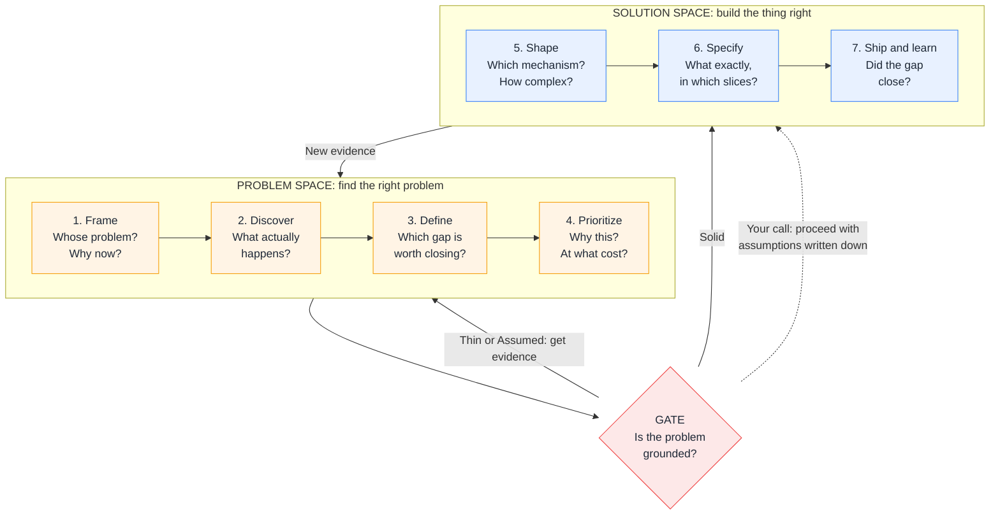
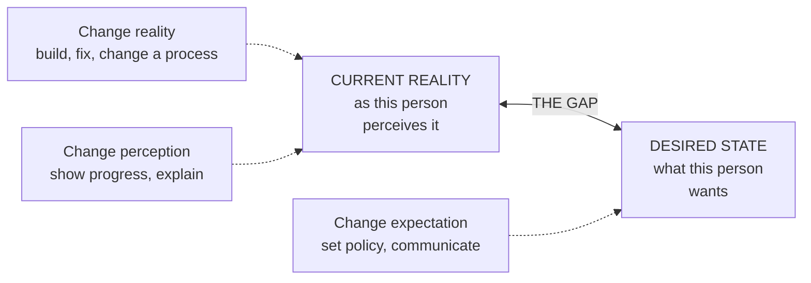
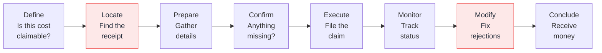
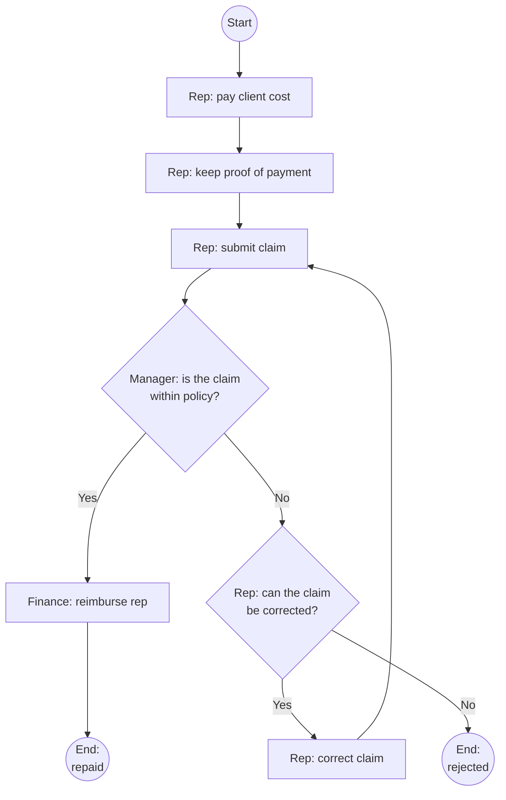
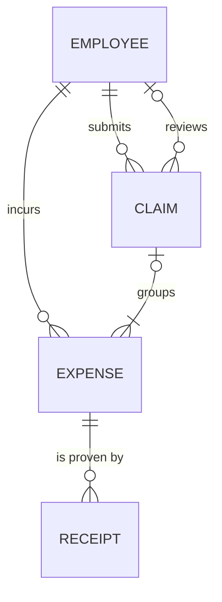
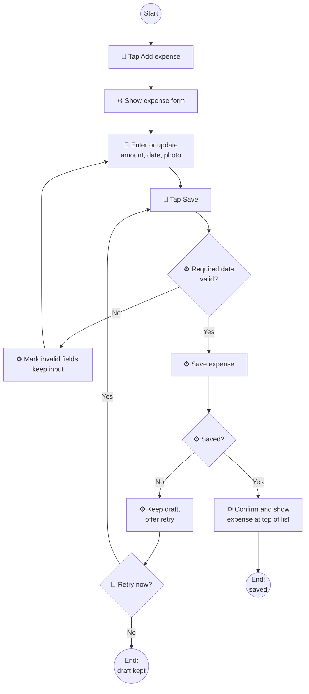
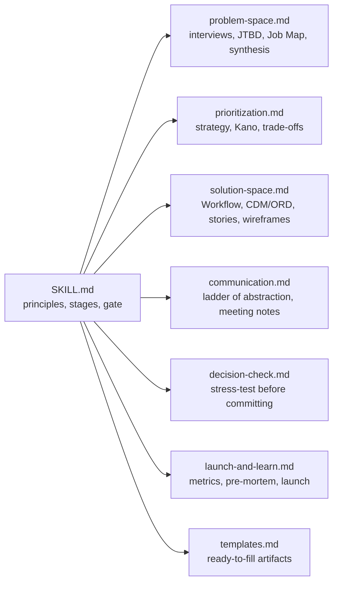

<div align="center">

# PM Workflow Skill

**A thinking partner for Product Managers that questions the problem before it helps you build the solution.**

[The journey](#the-journey) · [See it work](#see-it-work-from-a-request-to-a-wireframe) · [Install](#installation) · [Use](#usage)

</div>

---

## Why this exists

An AI assistant can write a PRD for almost any request. The result looks like progress, even when nobody has checked that the problem is real.

| You say | The easy answer | What `pm-workflow` is built to do |
| --- | --- | --- |
| "My boss wants reminders." | Write the reminder spec | Ask whose gap this closes and what evidence exists |
| "Users want an export button." | Add it to the backlog | Separate the suggested solution from the job behind it |
| "Here are 3 interviews." | Merge them into one need | Keep different jobs apart until evidence joins them |
| "The app is slow." | Recommend caching | Separate measured speed, perceived speed and expectation |

## The journey

Problem space gets the deepest thinking. Once it is solid, solution work becomes much easier, because you know what to keep and what to cut.



| Stage | Methods | You walk away with |
| --- | --- | --- |
| **Frame** | Value exchange; reality, perception and expectation | Hypothesis and research direction |
| **Discover** | Behaviour-based interviews, screeners, Job Map | Evidence from past events |
| **Define** | Jobs-to-be-done, job stories, coding raw data | Problem statement |
| **Prioritize** | Strategy fit, value and resources, Kano | Decision with its trade-off |
| **Shape** | Solution direction, Workflow, CDM / ORD | Mechanism and real complexity |
| **Specify** | User stories, activity diagrams, wireframes | Buildable, testable slices |
| **Ship and learn** | Metrics, pre-mortem, launch plan | Proof the gap closed, or the next question |

## How it thinks about a problem

A problem is the gap between **one specific person's** reality and what they want. There are three ways to move it, and building is often only one option.



---

## See it work: from a request to a wireframe

> **Illustrative walkthrough.** The company, people and findings are invented to show the kind of work the skill guides. It is not a recorded session.

### Step 0: The request

> **PM:** My manager wants push reminders, because sales reps file expense claims late. Write the PRD.

> **pm-workflow:** The solution is chosen, but the problem is still open. "Reminders" assumes reps *forget*. If they lose receipts, or cannot file while travelling, a reminder changes little.
>
> 1. What did the last late claim you know of look like, step by step?
> 2. Who is hurt by lateness: the rep, Finance, or both?
>
> If you need a draft today, I will write it with "reps forget" marked as an unverified assumption.

### Step 1: Discover with a Job Map

The job exists whether or not your product does. Interviews are organized along it.



<sub>Red marks the steps where the invented interviews showed the most pain.</sub>

### Step 2: Define the job story, then pass the gate

> **When** I pay a client cost from my own pocket while travelling, with no time to file it and a risk of never getting the money back,
> **I want to** keep proof tied to that cost,
> **so I can** be repaid in full without reconstructing it weeks later.

The job story names no solution. Before moving on, the problem is rated:

| Gate check | Status | Note |
| --- | :---: | --- |
| Specific subject and situation | ✅ | Travelling sales reps paying out of pocket |
| Current and desired reality | ✅ | Receipts get lost; reps want full repayment |
| Real past events and consequence | ✅ | 4 of 5 interviewees had absorbed a cost |
| Current workarounds ("hires") | ✅ | Photo gallery, message to self, paper envelope |
| No solution inside the statement | ✅ | |
| Linked to a current business goal | ⚠️ | Nobody has confirmed it is a priority |
| Something that would disprove it | ⚠️ | No finance data on rejected claims yet |

**Verdict: THIN.** Cheapest next step: ask Finance for last quarter's rejection reasons.

### Step 3: Shape the direction and the Workflow

| Direction | Verdict | Why |
| --- | :---: | --- |
| Push reminders | ❌ | Does not bring back a lost receipt |
| Flat travel allowance | ⏸️ | A policy change that Finance owns |
| **Capture proof at the moment of purchase** | ✅ | Acts where the gap starts |

The **Workflow** shows what must happen. The system is not an actor, and no screens or technology appear.



### Step 4: Expose complexity with a data model (CDM)

A few simple screens can hide a lot of structure. This is where estimates get honest.



### Step 5: Specify a user story

> **As a** sales rep, **I want to** attach a receipt photo to a new expense, **so that** I can be repaid in full later without searching for proof.

| Precondition | Value |
| --- | --- |
| Who | Signed-in rep, adding their own expense |
| Where | Expense list |
| Trigger | Taps **Add expense** |

**Acceptance criteria**

- **Given** amount, date and photo are filled in, **when** the rep saves, **then** the expense appears at the top of the list.
- **Given** a required field is empty, **when** the rep saves, **then** the field is marked and entered data is kept.
- **Given** saving fails, **when** the error shows, **then** the input is kept as a draft and the rep can retry.

### Step 6: Draw the activity diagram

Success appears only after the data is saved, and each failure leads to a next step. 👤 is the rep, ⚙️ is the system.



### Step 7: Sketch the wireframe

Deliberately plain, so the discussion stays on need and hierarchy. The photo comes first because proof is what gets lost.

```text
    EXPENSE LIST                ADD EXPENSE                 SAVED
+--------------------+     +--------------------+     +--------------------+
| My expenses        |     | < Add expense      |     | Expense saved      |
|                    |     |  +--------------+  |     |                    |
| Taxi        120.00 |     |  |  [ + PHOTO ] |  |     | NEW Lunch    45.00 |
| Hotel       890.00 | --> |  +--------------+  | --> | Taxi        120.00 |
|                    |     | Amount  [________] |     | Hotel       890.00 |
|                    |     | Date    [________] |     |                    |
| [ + Add expense ]  |     | [      Save      ] |     | [ + Add expense ]  |
+--------------------+     +--------------------+     +--------------------+
```

### Step 8: Communicate on the right rung

| To | Same finding, different message |
| --- | --- |
| **Executive** | Travelling reps are absorbing company costs because proof gets lost. We need Finance data to size it, then a priority decision. |
| **Engineering** | Proof is captured days after payment, or never. A failed save must keep the draft so the rep can retry. |
| **Design** | The rep is rushed and mid-travel. The photo is the first priority on screen. |

### Step 9: Ship and learn

| Metric | Type | Question it answers |
| --- | --- | --- |
| Share of claims rejected for missing proof | Outcome | Did the gap close? |
| Share of expenses with a photo added the same day | Input | Is capture happening at the moment of purchase? |
| Time to add one expense | Guardrail | Did we make filing heavier? |

Baselines are **unknown** here. They are measured before release, not invented, and the ship / iterate / stop rule is written before anyone reads the results.

---

## Principles

| # | Principle |
| :---: | --- |
| 1 | A problem is a gap between one specific subject's reality and what they want. |
| 2 | Problem space comes first and gets the most thought. |
| 3 | Requests are inputs, not validated problems. |
| 4 | Past behaviour beats opinion. |
| 5 | Make data concrete before abstracting it. |
| 6 | Discovery reduces uncertainty enough to place a bet. |
| 7 | Trade-offs are made in the open. |
| 8 | Context decides. |

**Guardrails:** no invented interviews, quotes, numbers or approvals. Facts, assumptions and recommendations stay separate. Depth matches the stakes, so a copy change does not require interviews.

## Installation

```bash
git clone https://github.com/dannyhoang249-hub/pm-vietnamese-skill.git
cp -r pm-vietnamese-skill/skills/pm-workflow <your-agent-skills-directory>/
```

Copy the whole folder, since `SKILL.md` loads the files in `references/`.

## Usage

| When you have | Try |
| --- | --- |
| A request from above | `Use pm-workflow. My manager wants in-app chat because a competitor launched it.` |
| Interview notes | `Use pm-workflow to turn these notes into job stories. Tell me what is missing.` |
| An urgent decision | `Use pm-workflow. Sprint planning is in 3 hours, users say the app is slow, engineering wants caching.` |
| Too much to do | `Use pm-workflow to help me choose between these three items. Our goal is activation.` |
| A feature to spec | `Use pm-workflow to model the workflow and data for this, then write user stories.` |
| A plan to stress-test | `Use pm-workflow to run a decision check and a pre-mortem on this PRD.` |

Output is in English by default. Ask for another language or a bilingual version when you need one.

## Inside the skill



The agent reads `SKILL.md` first and opens a reference when the work reaches it. Everything lives in [`skills/pm-workflow/`](skills/pm-workflow/).

## Upgrading from the earlier version

`pm-vietnamese`, `pm-bilingual`, `pm-karpathy-thinking` and the slash commands have been replaced by `pm-workflow`. Their feedback synthesis, meeting notes, metrics, pre-mortem, decision check and bilingual rules now live inside it. The old files remain in git history at commit `14fa030`.

## Acknowledgements

- The discovery-to-delivery method draws on the author's study in the *Breaking into Product Management* course. This is an independent, paraphrased adaptation, not affiliated with or endorsed by the course.
- Decision-check principles are adapted from [multica-ai/andrej-karpathy-skills](https://github.com/multica-ai/andrej-karpathy-skills).

## License

[MIT](LICENSE)
